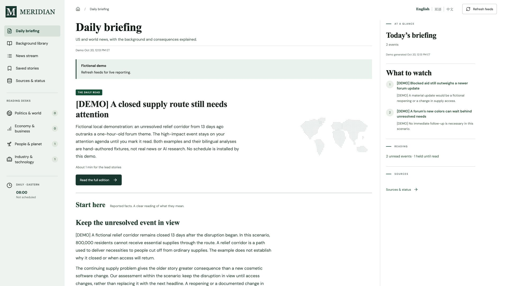

# Meridian News Desk

An English-first local news desk for US and world reporting, with optional Chinese reading, evidence-linked analysis and important events that stay visible until you mark them read.

Meridian collects public feeds and turns researched reporting into a continuing reading agenda. Short daily narratives explain what changed, the background a newcomer needs, and the consequences. The full analysis keeps sourced facts, attributed perspectives, editorial judgment and uncertainty distinguishable.



*The demo stories are fictional. Their reserved `.example` links are placeholders, not news sources.*

## What it does

- **Daily edition:** concrete editorial headlines and short narratives, with the original publisher title, full interpretation and evidence available in each detail view.
- **Four reading desks:** Politics & world, Economy & business, People & planet, and Industry & technology. Each reviewed event belongs to one desk to avoid duplicate reading.
- **Continuing agenda:** importance-based ranking, persistent read state and retained older events. A verified material development can reopen a read event; another copy of the same story cannot.
- **Background library:** dated, sourced bilingual explainers for institutions, conflicts, economics, development and technology. The repository bundles 23 starting guides; research imports can extend or revise them locally.
- **Language choices:** English by default, with Chinese and bilingual modes. Source summaries and full reviewed analysis are paired; new editorial headlines and short narratives may be English-only, with an explicit fallback to available translated facts.
- **News stream, saved stories and search:** browse the complete collection or a matching selection. Bookmarks and read state are separate.
- **Sources & status:** feed health, collection times, translation coverage and analysis gaps.

Collection, publisher translation, independent research and editorial ranking are separate stages. **Setup collects feeds; it does not automatically translate or analyze every article.** The standard research workflow uses Codex with browsing and local file access. This repository does not include an autonomous background LLM service or install your daily task.

## Quick start

Requires **Node.js 20+**, **Python 3.10+**, npm and Bash on **macOS or Linux**. Use WSL on Windows. Dependency installation and live feed collection need internet access.

```sh
git clone https://github.com/stevenchenjy/meridian-news-desk.git
cd meridian-news-desk
npm run setup
npm start
```

Open [localhost:4310](http://localhost:4310/). Setup creates `.venv`, installs dependencies, builds the frontend and collects enabled feeds. The server binds to `127.0.0.1`. A fresh collection shows publisher reporting and any translation or analysis gaps.

On macOS, [Open Meridian.command](Open%20Meridian.command) can later start the service and open the dashboard. If needed, run `chmod +x 'Open Meridian.command'` first.

### Try it with fictional stories

In a **fresh checkout without existing local data**:

```sh
npm run setup -- --skip-collect
npm run demo
npm start
```

The demo needs no Codex account and makes no publisher requests. It shows an older unresolved supply disruption ranked above a newer cosmetic update, short editorial narratives, bilingual full analysis and read controls. It refuses to overwrite existing data. The background library contains separately sourced, dated explainers; the demo news stories are invented.

## How research works

Follow the [daily workflow](docs/DAILY-WORKFLOW.md), [editorial rulebook](docs/EDITORIAL-RULEBOOK.md) and [analysis policy](docs/ANALYSIS-POLICY.md). Prepare and check each input before importing it:

```sh
npm run collect
.venv/bin/python scripts/apply_summaries.py --file data/summaries-input.json
.venv/bin/python scripts/apply_briefing.py --file data/briefing-input.json
.venv/bin/python scripts/apply_background.py --file data/background-input.json
```

Imports must match the exact collection timestamp. Publisher translation does not grant reviewed status. Selected briefing items require complete bilingual analysis, actual evidence links and an attention assessment. English editorial headlines and short reader briefs are required for newly reviewed events; Chinese versions of that reading layer are optional. The [schema](config/briefing-schema.json) describes the payload.

For wording changes without new facts, use `scripts/apply_editorial.py`. It preserves the reviewed analysis, evidence, factual dates and reading state. Structural validation checks references and data shape; the researcher remains responsible for actually checking sources and judging their support.

**Request analysis** queues a report for the next research run; it does not call a model immediately. **Refresh feeds** collects reporting asynchronously. An open dashboard polls local state every 30 seconds. This is scheduled research and feed collection, rather than continuous AI monitoring.

## Keep important events in view

The default policy retains a rolling 30 days of reporting. Reviewed events receive a 0–100 editorial importance score and a 1–30-day review horizon. These are judgments about consequences and continuing relevance, not probability or truth scores.

Events scoring 75 or above stay until explicitly marked read, including beyond their review horizon. Age subtracts at most five ranking points. Important unread snapshots and pending research requests are protected from ordinary pruning. Opening a story does not mark it read, and a new date or duplicate article does not justify reopening it.

See [attention policy](docs/ATTENTION-POLICY.md), [desk boundaries](docs/READING-SECTIONS.md) and [background maintenance](docs/BACKGROUND-GUIDES.md). Publication time, collection time, factual review date and next review date remain separate.

## Configure a daily task

A clone does **not** create a Codex automation. Open this repository as a local project, complete one manual research run, then configure your own daily task for **08:00 America/New_York**. Keep the computer, app and checkout available and review the first results. See the [workflow’s scheduling instructions](docs/DAILY-WORKFLOW.md) and [official scheduling documentation](https://learn.chatgpt.com/docs/automations).

A compact starting prompt:

> Update Meridian in this repository using docs/DAILY-WORKFLOW.md and its linked editorial, evidence, attention, reading-section and background policies. Collect public feeds, translate changed excerpts, research significant events and reader requests, maintain the background library, and import the exact snapshot. Preserve important unread events, material identities and factual dates. Verify saved data, APIs and the rendered dashboard. Report meaningful changes or failures briefly. Do not publish personal data or modify application code during ordinary daily runs.

[config/schedule.json](config/schedule.json) documents the default time and remains unconfigured for a new installation. A saved schedule does not prove that a future unattended run succeeded.

## Sources, privacy and foundation

Configure feeds in [config/sources.json](config/sources.json). The catalog covers newsrooms, UN channels, central banks, research and public discussions. Forum posts are attributed perspectives. **LinkedIn is unconnected.** Some full articles or primary records may be inaccessible; reviewed analysis should state the actual evidence limits.

Personal reporting, translations, analysis archives, bookmarks, reading state and queued requests live in the ignored `data/` directory. Back it up to preserve your history. The public repository includes no personal dashboard archive, active account automation or credentials. The loopback service does not publish your dashboard externally.

Meridian directly reuses the **TrendRadar RSS/Atom/JSON Feed parser**, vendored unchanged at [commit ceabb027](https://github.com/sansan0/TrendRadar/commit/ceabb027fe9bbdafec59dbbfa12cb46c2ba256ce). The local storage, research workflow and React/Vite dashboard are Meridian code; this is a parser-based derivative, not the full TrendRadar application. See the dated [framework comparison](docs/FRAMEWORK-RESEARCH.md) and [component provenance](vendor/trendradar/PROVENANCE.md).

Distributed under **GPL-3.0-only**. The [project license](LICENSE) and [preserved upstream license](vendor/trendradar/LICENSE) are included.

## Development

```sh
npm test
npm run build
```

Use `npm start` for the local server and `npm run dev` for Vite development; Vite proxies `/api` to port 4310. See [architecture](docs/ARCHITECTURE.md) and [contribution guidance](CONTRIBUTING.md). UI changes require checking the rendered result, and public releases should update the README, demo image and repository description when their claims change.
