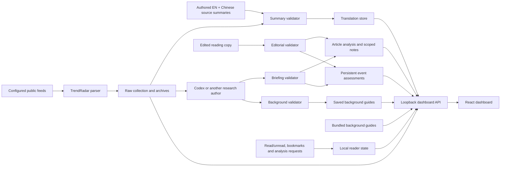

# Architecture and extension points

Meridian separates feed collection, source-text translation, research analysis, editorial reading copy, background guides and reader attention. The Python service serves the compiled React UI and a loopback JSON API; it does not call a language-model API when a reader opens a story.

## Authoritative inputs and outputs

| File or component | Role |
| --- | --- |
| `config/sources.json` | Public feed catalog, topic lenses and collection controls. |
| `config/reading-sections.json` | Four reading-desk labels, scope descriptions and legacy source-category fallback mapping. |
| `config/attention-policy.json` | Retention window, important-unread threshold and bounded age penalty. |
| `config/background-*.json` | Dated bilingual guides bundled with a fresh installation. |
| `config/schedule.json` | Portable scheduling preference; fresh clones are not scheduled. |
| `config/schedule.local.json` | Ignored override recording an individual's confirmed schedule setup. |
| `data/dashboard.json` | Current raw reporting and validated article/briefing analysis. |
| `data/summaries.json` | Fingerprinted publisher-excerpt or headline translations. |
| `data/attention.json` | Semantic events, material versions, assessed importance and reviewed snapshots. |
| `data/background-guides.json` | Researched guide additions and revisions, merged by stable guide ID over the bundled library. |
| `data/background-imports/` | Accepted background batches with their import receipts. |
| `data/briefings/` | Briefing and editorial import archives, separate from factual review dates. |
| `data/read-state.json`, `bookmarks.json`, `analysis-requests.json` | Independent reader choices and durable research requests. |
| `server/newsroom.py` | Collection, atomic file updates, validation and merged dashboard state. |
| `server/background.py` | Guide validation, persistent imports and merged background-library metadata. |
| `server/app.py` | Local HTTP routes, asynchronous feed refresh and static asset serving. |
| `src/lib/attention.js` | UI selectors that preserve a reviewed event when its raw source changes or leaves. |
| `src/lib/sections.js` | Exclusive event routing and canonical unread desk counts. |
| `src/lib/briefing.js` | Selects notes, background, watches and source counts for the visible view, topic and reader filters. |
| `src/lib/editorial.js` | Selects current or retained reviewed headlines and short narratives, with language fallbacks. |
| `src/lib/background.js` | Matches related guides to visible reporting and filters the library. |

Generated files and state are ignored by Git. Archives retain the collection and imports used for a past assessment. They are evidence of local generation, not proof of successful unattended execution or external publication.

## Collection and content identity

The source catalog is fetched concurrently with bounded requests. Article IDs use canonicalized source URLs, ignoring tracking parameters and fragments. Failed feeds retain their last successful reporting with explicit status. Source publication time, actual event date, collection time and research time are different fields; an old feed entry does not become a new event when collected.

Translations and research are associated with a content fingerprint. A real title/excerpt change invalidates current derived content. Hacker News vote and comment counters are excluded from content identity. Important reviewed snapshots remain available with historical/review-needed labels while current reporting awaits a new assessment.

## Analysis imports

An import must target the exact current collection timestamp. Every selected briefing item requires a complete matching bilingual article overlay and an attention assessment. Evidence must include the original report's URL. Extra overlays can fulfill research requests without appearing in the overview. Validation checks structure and provenance consistency; the author remains responsible for actually researching the claims and recording source-access limits.

Copying identical factual analysis preserves its original `analyzedAt` unless the author explicitly sets `reverified: true` after rechecking evidence. A priority reassessment has its own `reviewedAt`. The application completes a research request only when current complete bilingual analysis is saved.

Newly authored analyses include an English editorial `headline` and short `readerBrief`; Chinese is optional for these two fields. The original publisher title remains intact. `scripts/apply_editorial.py` can revise this reading copy, the edition title, overview and scoped notes against the exact collection timestamp. It updates compatible current and retained reviewed artifacts in `data/dashboard.json` and `data/attention.json`, then archives the accepted edit. It preserves factual summaries, evidence, review dates, material identities and reader state; it cannot fulfill a factual-review request.

## Background library

`scripts/apply_background.py` validates complete bilingual guides against the exact collection timestamp and saves them in `data/background-guides.json`. The API merges these guides over `config/background-*.json` by stable ID and reads the saved overlay on each request. Applying research needs no frontend rebuild or server restart. An open dashboard receives it on its next poll or reload.

Guide factual dates remain distinct from collection and import dates. Unchanged or metadata-only edits preserve the existing factual dates unless `reverified: true` records an actual evidence check. An empty import can record a no-change maintenance pass. Corrupt saved research produces an explicit load error rather than a successful empty library. See [BACKGROUND-GUIDES.md](BACKGROUND-GUIDES.md) for the guide contract and research workflow.

## Reading desks, context and section notes

A briefing may include `sectionNotes` for `all`, `politics`, `economy`, `development` and `industry`. Older source-topic scopes remain supported for compatibility. Each scope holds one to three short bilingual notes with a title, a latest-development summary, optional background and reviewed article references. Background explains the actors, institution roles or key terms before the development. Imports validate both languages, length, complete reviewed references and topic membership, including related categories and retained reviewed snapshots. They do not establish factual truth.

The four reading desks have exclusive event membership. An editorial `attention.readingSection` takes precedence over source-feed categories, and all member reports inherit it. Secondary `relatedCategories` do not add reading-desk membership. The sidebar opens the ranked researched agenda, while News stream retains the complete collection. See [READING-SECTIONS.md](READING-SECTIONS.md) for boundaries and fallback behavior.

The sidebar rail and expanded reading brief share the same selector. Topic notes must reference the visible reporting or its matching assessed event. Saved stories and text searches derive notes from their actual selection. A missing scope uses only that selection's bilingual summaries and reviewed context; it never borrows the global overview. Source-only notes remain labeled as source summaries, without invented analysis. Empty selections stay empty.

Notes retain the underlying articles' research timestamps. Editing their prose does not reverify the facts. Reviewed details lead with the short reader narrative when available, or the reviewed summary as a fallback. Original publisher titles, factual review dates and evidence links remain visible. Expandable sections retain the full background, interpretation, uncertainty and watch indicators. Dashboard-retention metadata is also expandable so the reader can reach the story first.

## Ranking and reading state

An event uses a stable `eventKey`; the checked material development uses a stable `updateKey`. Supporting reports share reading state without becoming duplicate positions in the agenda. Assessments of one event in the same import must agree on the material version and retention decisions.

Priority is the editorial importance score minus a small age penalty based on time since priority review and its horizon. The penalty is capped by policy, currently at five points. Scores of at least 75 remain in the unread agenda until explicitly marked read, including beyond the normal 30-day reporting window. Other context can leave the active agenda at its horizon while remaining available under All assessed.

A new collection date or minor edit does not reset reading state. A reviewed material development can reopen an event. Read requests carry the expected `updateKey`, preventing an older open detail from marking an unseen new development read. Opening a detail or source link does not mark it read.

## Public demo and fresh installations

The demo seeds only a fresh workspace and uses the same validators as real imports. `collection.kind` is `synthetic_demo`, with a visible fictional-data banner and sample-analysis labels. First real collection removes the fictional demo state instead of retaining it as ongoing news. Seed refusal protects an existing personal collection.

Live collection alone adds publisher reporting. An author must supply source translations and researched analysis through the documented imports, manually or through their own scheduled Codex workflow. The server's 30-second UI polling reads saved state; it is not continuous AI research.

## Extending the project

Add feeds in the source catalog and preserve their source type and access limits. Keep new adapters separate from the pinned parser. Alternative research agents can produce the documented JSON contracts; use [ANALYSIS-POLICY.md](ANALYSIS-POLICY.md) and [ATTENTION-POLICY.md](ATTENTION-POLICY.md) to maintain dating, scope and retention behavior. See [CONTRIBUTING.md](../CONTRIBUTING.md) for local checks.
